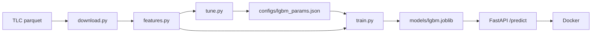

# Taxi ETA - предсказание длительности поездки на такси в Нью-Йорке

Сквозной ML-сервис: загрузка открытых данных -> обучение модели -> REST API -> Docker.
Сейчас в сервисе работает LightGBM с временными признаками, гиперпараметры подобраны
через Optuna. Дальше буду углублять остальные этапы (см. раздел "Планы").

## Задача

По данным, которые известны в момент заказа (зона посадки, зона высадки, время),
предсказать длительность поездки в минутах.

Метрика - MAE (средняя абсолютная ошибка, в минутах):

$$\mathrm{MAE} = \frac{1}{n}\sum_{i=1}^{n} |y_i - \hat y_i|$$

## Результаты

Все модели обучены на январе и феврале 2024 и проверены на марте 2024.
Март не использовался ни при подборе гиперпараметров, ни при ранней остановке.

| Модель                       | MAE на тесте (март), мин |
|------------------------------|--------------------------|
| Константа (общая медиана)    | X.XX                     |
| Медиана по паре зон          | X.XX                     |
| LightGBM                     | 3.46                     |

LightGBM лучше медианы по паре зон на X.XX мин (X%).

Размер выборок: train - 1000000 поездок, test - 300000 поездок.

## Данные

[NYC TLC Trip Record Data](https://www.nyc.gov/site/tlc/about/tlc-trip-record-data.page) -
открытые данные о поездках жёлтого такси, по одному parquet-файлу на месяц.

Очистка:
- оставлены только поездки, которые начались внутри своего месяца (в файлах встречаются ошибочные даты);
- оставлены поездки длительностью от 1 до 120 минут.

Признаки:
- `PULocationID`, `DOLocationID` - зоны посадки и высадки (категориальные);
- `pickup_hour` - час посадки;
- `pickup_dow` - день недели (0 - понедельник).

## Модель

LightGBM с функцией потерь L1, то есть модель напрямую минимизирует ту же
величину, что и метрика:

$$L(y, F) = |y - F|$$

Зоны переданы как категориальные признаки: сплит в дереве имеет вид
"зона входит в множество S", а не "номер зоны меньше 150".

### Подбор гиперпараметров

Optuna (сэмплер TPE), 30 испытаний. Обучение на подвыборке января (1 млн поездок),
валидация на подвыборке февраля (300 тыс.). Число деревьев в каждом испытании
определяется ранней остановкой (терпение 50 деревьев).

| Параметр            | Диапазон поиска (лог-шкала) | Лучшее значение |
|---------------------|-----------------------------|-----------------|
| `learning_rate`     | 0.02 - 0.3                  | 0.34            |
| `num_leaves`        | 16 - 512                    | 379             |
| `min_child_samples` | 20 - 2000                   | 138             |
| `reg_lambda`        | 0.001 - 10                  | 0.874           |
| `cat_smooth`        | 1 - 100                     | 5.98            |

Лучшие параметры сохраняются в `configs/lgbm_params.json`.

### Финальное обучение

1. Обучение на полном январе с ранней остановкой по полному февралю - так находится число деревьев (N).
2. Обучение на январе и феврале с этим числом деревьев.
3. Одна проверка на марте.

## Быстрый старт

Нужны Python 3.12 и Docker. На macOS для LightGBM нужен OpenMP: `brew install libomp`.

```bash
git clone <ссылка на репозиторий>
cd taxi-eta
python -m venv .venv
source .venv/bin/activate          # Windows: .venv\Scripts\activate
pip install -r requirements.txt

python -m src.download             # скачать данные (~150 МБ)
python -m src.tune                 # подбор гиперпараметров (необязательно, ~10-30 мин)
python -m src.train                # обучить модели и вывести MAE

docker build -t taxi-eta:0.2 .
docker run --rm -p 8000:8000 taxi-eta:0.2
```

Шаг `src.tune` можно пропустить: подобранные параметры уже лежат в `configs/lgbm_params.json`.

## Пример запроса

Поездка из аэропорта JFK (зона 132) на Таймс-сквер (зона 230) утром в понедельник:

```bash
curl -X POST http://127.0.0.1:8000/predict \
  -H "Content-Type: application/json" \
  -d '{"pickup_datetime": "2024-04-01T08:30:00", "PULocationID": 132, "DOLocationID": 230}'
```

```json
{"duration_min": X.X}
```

Та же поездка ночью в воскресенье (`"pickup_datetime": "2024-04-07T04:00:00"`):

```json
{"duration_min": X.X}
```

Документация API (Swagger): http://127.0.0.1:8000/docs

## Структура проекта



- `src/download.py` - загрузка данных (повторный запуск ничего не скачивает заново)
- `src/features.py` - очистка, целевая переменная, признаки, список признаков
- `src/baseline.py` - бейзлайн: медиана по паре зон
- `src/lgbm_model.py` - обёртка над LightGBM с тем же интерфейсом fit/predict, что у бейзлайна
- `src/tune.py` - подбор гиперпараметров через Optuna
- `src/train.py` - обучение всех моделей и проверка на тесте
- `src/api.py` - REST API на FastAPI
- `configs/lgbm_params.json` - подобранные гиперпараметры

## Почему сделано именно так

- Разбиение по времени на три части: январь - обучение, февраль - валидация для
  подбора гиперпараметров и ранней остановки, март - тест. Если подбирать
  параметры по тому же месяцу, на котором считается итоговая MAE, оценка
  получается завышенной: из многих конфигураций выбирается та, которой
  повезло именно на этих данных.
- Функция потерь L1, потому что метрика - MAE. Значения в листьях деревьев при
  L1 - это медианы остатков, а медиана и есть константа, минимизирующая MAE.
- Признак `trip_distance` не используется. Это фактическое расстояние, оно
  известно только после поездки, то есть это утечка целевой переменной.
- Зоны - категориальные признаки, но хранятся как обычные целые числа (а не
  pandas `category`). API получает числа, и модель обучается на данных того же вида.
- Час и день недели без sin/cos-кодирования. Дерево делит выборку порогами и
  может выделить любой интервал часов, циклическое кодирование ему не нужно.
- Подбор на подвыборке, чтобы 30 испытаний занимали минуты, а не часы.
- Одна и та же функция признаков для обучения и для API, и один список
  признаков `FEATURES` для всех скриптов. Так признаки в сервисе гарантированно
  считаются так же, как при обучении (нет training-serving skew).
- Обёртка `LGBMDurationModel` сама выбирает нужные колонки в нужном порядке.
  LightGBM различает признаки по позиции, и перепутанный порядок колонок
  не дал бы ошибки, а молча испортил бы предсказания.

## Ограничения

- Гиперпараметры подобраны на подвыборке. Предполагается, что лучшие
  конфигурации на подвыборке и на полных данных совпадают, это не проверялось.
- Число деревьев найдено на одном месяце обучения, а финальная модель
  обучена на двух. На большем объёме оптимум обычно чуть больше, так что
  модель может быть немного недообучена.
- Не учитываются праздники, погода и пробки в реальном времени.
- Если пара зон редко встречалась в обучении, предсказание для неё
  ненадёжное (частично помогают `cat_smooth` и `min_child_samples`).
- Модель лежит внутри Docker-образа, чтобы её обновить, нужно пересобрать образ.
- Один `requirements.txt` на обучение и сервис, поэтому в образ попадают
  лишние пакеты (например, Optuna).

## Планы

- [x] Тонкая версия: бейзлайн -> API -> Docker
- [x] LightGBM с временными признаками, подбор гиперпараметров через Optuna
- [ ] Анализ ошибок по часам, зонам и длине поездки
- [ ] Трекинг экспериментов и реестр моделей в MLflow
- [ ] Тесты (pytest) и CI в GitHub Actions
- [ ] Мониторинг дрейфа данных (PSI)
- [ ] Автоматическое переобучение
- [ ] Демо на Streamlit или Hugging Face Spaces