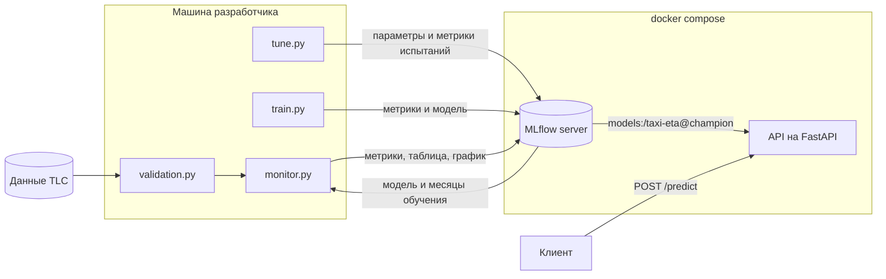

# Taxi ETA - предсказание длительности поездки на такси в Нью-Йорке

Сквозной ML-сервис и пайплайн вокруг него. Модель LightGBM обучается на поездках
жёлтого такси, гиперпараметры подбираются через Optuna, эксперименты и версии
моделей хранятся в MLflow, а сервис загружает актуальную модель из реестра.
Каждый месяц данных проходит автоматическую проверку, а мониторинг измеряет
качество модели на новых месяцах и дрейф данных.

На данных за 2022-2025 годы мониторинг показал, что ошибку модели определяет
прежде всего сезонность, а не возраст модели. С его помощью удалось оценить
эффект платы за въезд в центр Манхэттена, введённой в январе 2025 года.

## Задача

По зоне посадки, зоне высадки и времени заказа нужно предсказать длительность
поездки в минутах. Используются только признаки, которые известны в момент заказа.

Качество оценивается по средней абсолютной ошибке (MAE) в минутах.

$$\mathrm{MAE} = \frac{1}{n}\sum_{i=1}^{n} |y_i - \hat y_i|$$

## Результаты модели

Все модели обучены на поездках за январь и февраль 2024 года и проверены
на поездках за март 2024 года. Мартовские данные не использовались
ни при подборе гиперпараметров, ни при ранней остановке.

| Модель                    | MAE на тесте (март), мин |
|---------------------------|--------------------------|
| Константа (общая медиана) | 8.46                     |
| Медиана по паре зон       | 4.41                     |
| LightGBM                  | 3.60                     |

LightGBM ошибается в среднем на 0.81 мин меньше, чем медиана по паре зон. В обучающей выборке 5,897,742 поездок, в тестовой 3,538,513.

## Данные

Используются открытые данные
[NYC TLC Trip Record Data](https://www.nyc.gov/site/tlc/about/tlc-trip-record-data.page),
по одному parquet-файлу на месяц, и справочник зон TLC.

При очистке удаляются строки с пропусками, поездки, которые начались за пределами
своего месяца, поездки короче 1 минуты и длиннее 120 минут, а также поездки
с несуществующими номерами зон.

| Признак        | Описание                                  |
|----------------|-------------------------------------------|
| `PULocationID` | зона посадки (категориальный признак)     |
| `DOLocationID` | зона высадки (категориальный признак)     |
| `pickup_hour`  | час посадки                               |
| `pickup_dow`   | день недели, 0 соответствует понедельнику |

### Проверка данных

Перед использованием каждый месяц проходит проверку (`src/validation.py`).
Проверяются читаемость файла, наличие и типы нужных колонок, объём данных,
доля пропусков и доля строк, которые проходят правила очистки. Ошибка
останавливает работу с месяцем, предупреждение только сообщает об изменении.
Пороги выставлены по истории за 2022-2025 годы с запасом относительно худшего
нормального месяца.

Порог доли поездок внутри своего месяца сначала был выставлен по 2024-2025
годам и дал ложную тревогу на июне 2022 года, где таких поездок оказалось
144 на миллион против не более 17 на миллион в 2024-2025 годах. Порог ослаблен
до 0.999, потому что проверка нужна для поиска перепутанных или склеенных
файлов, где доля падает намного сильнее.

### Что изменилось в данных в 2025 году

- Появилась колонка `cbd_congestion_fee`, связанная с платой за въезд в центр Манхэттена.
- Поездок стало на 13-23% больше, чем в те же месяцы 2024 года. Поездки, которые
  начинаются или заканчиваются в зоне платы, выросли на 10-18%, остальные
  на 18-32%, поэтому доля поездок через зону платы снизилась с 73-75% до 71-72%.
- Вдвое выросла доля поездок короче минуты (1.2% в июне 2024 года против 2.7%
  в июне 2025 года). Такие поездки отбрасываются при очистке, их природа
  пока не установлена.

## Архитектура



Обучение и сервис связаны только через реестр моделей MLflow. Скрипты обучения
отправляют параметры, метрики и модели на сервер MLflow, а сервис при запуске
запрашивает у реестра версию модели с алиасом `champion`. Чтобы обновить модель
в сервисе, достаточно перевесить алиас на другую версию и перезапустить контейнер.

Мониторинг берёт из реестра ту же модель, а из запуска, который её создал,
список месяцев обучения. По этим месяцам строится эталон для оценки дрейфа.

## Модель

Используется LightGBM с функцией потерь L1, так что модель напрямую минимизирует
ту же величину, что и метрика, и предсказывает условную медиану длительности.

$$L(y, F) = |y - F|$$

Зоны переданы в модель как категориальные признаки. Сплит в дереве имеет вид
"зона входит в множество S", а не "номер зоны меньше 150".

### Подбор гиперпараметров

Гиперпараметры подобраны с помощью Optuna (сэмплер TPE) за 30 испытаний.
Обучение в каждом испытании идёт на подвыборке января (1 млн поездок), а проверка
на подвыборке февраля (300 тыс. поездок). Число деревьев определяется ранней
остановкой с терпением 50 деревьев.

| Параметр            | Диапазон поиска (лог-шкала) | Лучшее значение |
|---------------------|-----------------------------|-----------------|
| `learning_rate`     | 0.02 - 0.3                  | 0.034           |
| `num_leaves`        | 16 - 512                    | 379             |
| `min_child_samples` | 20 - 2000                   | 138             |
| `reg_lambda`        | 0.001 - 10                  | 0.874           |
| `cat_smooth`        | 1 - 100                     | 5.98            |

### Финальное обучение

1. Модель обучается на полном январе с ранней остановкой по полному февралю, так находится число деревьев.
2. С этим числом деревьев модель обучается заново на январе и феврале вместе.
3. Готовая модель один раз проверяется на марте.

Модель сохраняется в формате MLflow pyfunc вместе с исходным кодом и сигнатурой
входа, регистрируется в реестре под именем `taxi-eta`, и новой версии
присваивается алиас `champion`.

## Мониторинг

Мониторинг (`src/monitor.py`) проходит по месяцам после окончания обучающего
окна. Для каждого месяца он проверяет данные, делает предсказания модели
и сравнивает их с фактической длительностью поездок. Месяц для модели всегда
новый, она его не видела, поэтому это честная оценка качества во времени.

Метрики считаются по случайной подвыборке в 300 тыс. поездок на месяц, эталон
для дрейфа берётся подвыборкой в 500 тыс. поездок из месяцев обучения.
Стандартная ошибка медианы остатков на такой подвыборке порядка 0.01-0.02 мин,
смещение PSI из-за конечной выборки порядка 0.001, что пренебрежимо мало
на фоне изучаемых эффектов.

| Метрика | Что показывает |
|---|---|
| `mae`, `mae_cbd`, `mae_outside` | ошибка модели в целом, в зоне платы и вне её |
| `bias_cbd`, `bias_outside` | медиана остатков $y - \hat y$ в каждой группе, то есть направление ошибки |
| `bias_gap` | разность медиан остатков в зоне платы и вне её |
| `psi_*` признаков | дрейф распределения входов модели |
| `psi_duration` | дрейф распределения фактической длительности |
| `psi_prediction` | дрейф распределения предсказаний |

PSI считается как симметризованная дивергенция Кульбака-Лейблера между долями
категорий в новом месяце $p_i$ и в эталоне $q_i$.

$$\mathrm{PSI} = \sum_i (p_i - q_i)\ln\frac{p_i}{q_i}$$

Поездка относится к зоне платы, если начинается или заканчивается в ней.
Список зон TLC внутри зоны платы выведен из данных (`src/cbd_zones.py`).
Поездки, начавшиеся в зоне платы, платят сбор всегда, поэтому зона TLC считается
лежащей внутри зоны платы, если сбор заплатили почти все поездки из неё.
Доли у зон внутри лежат от 0.94 до 0.99, у ближайших зон снаружи не превышают
0.58, порог 0.75 выбран посередине этого разрыва. Получилось 37 зон, все
в Манхэттене южнее 60-й улицы.


### Что показал мониторинг

**Ошибку модели определяет сезонность, а не возраст модели.** Лучше всего модель
работает в январе и феврале 2025 года (MAE 3.27 и 3.28), то есть через год после
обучения, но в том же сезоне. Хуже всего в сентябре и декабре 2024 года
(4.81 и 5.38). Корреляция MAE с медианой остатков вне зоны платы по 16 месяцам
равна 0.85, то есть плохие месяцы это в первую очередь систематическая
недооценка длительности в загруженные сезоны. Модель, обученная на двух
зимних месяцах, это модель одного сезона.

**Дрейф признаков не означает деградацию.** PSI зон посадки в 2025 году растёт
и к июню достигает 0.146, состав поездок заметно меняется. При этом MAE в 2025
году ниже, чем в тех же месяцах 2024 года. С качеством модели связан PSI
фактической длительности (корреляция с MAE 0.87), но для него нужны ответы.
Поэтому триггером переобучения должен быть сигнал по остаткам, а не PSI признаков.

**Рост поездок пришёлся в основном на поездки вне центра.** Это объясняет, почему
общая медиана длительности в 2025 году выросла, хотя поездки через центр,
как показано ниже, относительно ускорились.

## Эффект платы за въезд в центр Манхэттена

### Метод

Модель обучена на зиме 2024 года, поэтому её предсказание отвечает на вопрос,
сколько длилась бы такая же поездка (та же пара зон, тот же час и день недели)
в условиях до введения платы. Остаток $r = y - \hat y$ показывает, насколько
реальность отличается от этого прогноза. Состав поездок при этом учитывается
автоматически, потому что модель знает пару зон, час и день недели.

Модель обучена на потере L1 и предсказывает условную медиану, поэтому без
изменений в мире медиана остатков в любой группе, заданной через признаки,
близка к нулю. Сезонность модель не знает, и она сдвигает остатки во всех
группах сразу, поэтому сравнивается разность групп.

$$\Delta(M) = \operatorname{med}\big(r \mid \text{зона платы}, M\big) - \operatorname{med}\big(r \mid \text{вне зоны}, M\big)$$

У центра оказалась своя сезонность (в декабре 2024 года $\Delta = 1.52$),
поэтому сравниваются одни и те же календарные месяцы разных лет.

### Результат

| Месяц  | 2022  | 2023  | 2024  | 2025  |
|--------|-------|-------|-------|-------|
| март   | -0.58 | -0.00 | +0.26 | -0.11 |
| апрель | -0.50 | -0.09 | +0.41 | +0.18 |
| май    | -0.43 | -0.04 | +0.40 | +0.29 |
| июнь   | -0.15 | +0.10 | +0.41 | +0.27 |


С 2022 по 2024 год поездки через центр год за годом становились медленнее
относительно остального города, примерно на 20-25 секунд в год. Все восемь
изменений год к году до введения платы положительны. В 2025 году тренд
развернулся во всех четырёх месяцах.

Если построить линейный тренд по 2022-2024 годам отдельно для каждой группы,
медиана остатков в центре в 2025 году оказывается ниже тренда на 0.57-0.99 мин,
а вне центра только на 0.11-0.16 мин. Изменение сосредоточено там, где действует
плата.

Величина эффекта зависит от допущения о том, что было бы без платы.

| Допущение | Эффект на $\Delta$, мин | В среднем |
|---|---|---|
| рост остановился бы на уровне 2024 года | от -0.11 до -0.38 | -0.21 (около 13 с) |
| рост продолжился бы линейно | от -0.41 до -0.85 | -0.61 (около 37 с) |

Итоговая оценка эффекта от 13 до 37 секунд, то есть примерно 2-6% времени
поездки через центр.

### Как менялся анализ

| Шаг | Метод | Проблема | Решение |
|---|---|---|---|
| 1 | общая медиана длительности | смешаны группы, состав поездок и сезон | модель как прогноз "что было бы" |
| 2 | разность групп месяц к месяцу | у центра своя сезонность | сравнение год к году |
| 3 | изменение разности год к году | не прошёл плацебо-тест на паре 2023-2024 | добавлен 2022 год |
| 4 | излом тренда 2022-2025 | мало лет, допущение о тренде | две оценки как интервал |

Плацебо-тест на паре 2023-2024 годов, где реформы не было, дал изменения
от +0.26 до +0.50 мин, больше по модулю, чем предполагаемый эффект. Данные
за 2022 год показали, что это не шум, а устойчивый тренд, и сравнивать 2025 год
нужно с продолжением тренда, а не с прошлым годом.

### Ограничения анализа

- Независимых наблюдений столько, сколько лет, то есть мало. Месяцы одного
  года подвержены общим событиям и не независимы.
- Линейное продолжение тренда это сильное допущение. Рост трафика после
  пандемии рано или поздно должен был выйти на плато.
- Поездки, которые проезжают через зону платы транзитом, отнесены к группе
  "вне зоны". Это тянет оценку эффекта к нулю.
- Если в 2025 году в центре изменилось что-то ещё, это попадёт в ту же оценку.
- Месяцы 2022 и 2023 годов оценивались по подвыборке в 100 тыс. поездок,
  месяцы 2024 и 2025 годов по подвыборке в 300 тыс.

## Быстрый старт

Для запуска нужны Python 3.12 и Docker. На macOS для LightGBM дополнительно
нужен OpenMP (`brew install libomp`).

```bash
git clone <ссылка на репозиторий>
cd taxi-eta
python -m venv .venv
source .venv/bin/activate
pip install -r requirements.txt

python -m src.download 2024-01 2025-06
python -m src.validation 2024-01 2025-06

docker compose up -d mlflow
export MLFLOW_TRACKING_URI=http://localhost:5000

python -m src.tune
python -m src.train
docker compose up -d --build api

python -m src.cbd_zones
python -m src.monitor 2024-01 2025-06
python -m src.plot_trend_break
```

В Windows (cmd) окружение активируется командой `.venv\Scripts\activate`,
а адрес сервера задаётся командой `set MLFLOW_TRACKING_URI=http://localhost:5000`.

Шаг `src.tune` можно пропустить, потому что подобранные параметры уже лежат
в `configs/lgbm_params.json`. Шаг `src.cbd_zones` тоже можно пропустить,
список зон лежит в `configs/cbd_zones.json`.

Сервис API нужно запускать после `src.train`. До этого в реестре нет модели
с алиасом `champion`, и сервис не сможет стартовать.

Для плацебо-теста нужно скачать и проверить 2022 и 2023 годы
(`python -m src.download 2022-03 2023-06`), затем запустить мониторинг
на диапазонах `2022-03 2022-06` и `2023-03 2023-06`. Каждый запуск сохраняет
отчёт в отдельный файл с диапазоном месяцев в имени.

Интерфейс MLflow открывается по адресу http://localhost:5000, документация API
по адресу http://localhost:8000/docs.

## Пример запроса

Поездка из аэропорта JFK (зона 132) на Таймс-сквер (зона 230) утром в понедельник.

```bash
curl -X POST http://127.0.0.1:8000/predict \
  -H "Content-Type: application/json" \
  -d @request.json
```

Файл `request.json` лежит в корне репозитория.

```json
{"pickup_datetime": "2024-04-01T08:30:00", "PULocationID": 132, "DOLocationID": 230}
```

Сервис возвращает предсказанную длительность в минутах.

```json
{"duration_min": 60.2}
```

## Структура проекта

| Файл                       | Назначение |
|----------------------------|------------|
| `src/months.py`            | работа с месяцами и разбор аргументов командной строки |
| `src/download.py`          | загрузка данных и справочника зон, защита от недокачанных файлов |
| `src/features.py`          | чтение, очистка, целевая переменная, признаки, подготовка входа модели |
| `src/validation.py`        | проверка сырых данных месяца |
| `src/baseline.py`          | бейзлайн, медиана по паре зон |
| `src/lgbm_model.py`        | обёртка над LightGBM с тем же интерфейсом, что у бейзлайна |
| `src/mlflow_model.py`      | упаковка модели в формат MLflow pyfunc |
| `src/tune.py`              | подбор гиперпараметров через Optuna с записью в MLflow |
| `src/train.py`             | обучение, проверка на тесте, регистрация модели |
| `src/api.py`               | REST API на FastAPI |
| `src/cbd_zones.py`         | вывод списка зон внутри зоны платы из данных |
| `src/drift.py`             | PSI для категориальных и непрерывных величин |
| `src/monitor.py`           | мониторинг модели по месяцам |
| `src/plot_trend_break.py`  | график разности смещений по годам |
| `configs/lgbm_params.json` | подобранные гиперпараметры |
| `configs/cbd_zones.json`   | зоны TLC внутри зоны платы |
| `reports/`                 | таблицы и графики мониторинга |
| `Dockerfile`               | образ сервиса API |
| `Dockerfile.mlflow`        | образ сервера MLflow |
| `docker-compose.yml`       | запуск сервера MLflow и API |

## Почему сделано именно так

- Данные разбиты по времени. Январь используется для обучения, февраль для подбора
  гиперпараметров и ранней остановки, март для итоговой проверки модели.
- Функция потерь L1 выбрана потому, что метрика проекта MAE. Модель с такой
  потерей предсказывает условную медиану, и на этом свойстве построен мониторинг
  смещения.
- Признак `trip_distance` не используется. Это фактическое расстояние, оно
  становится известно только после поездки.
- Всё, что должно совпадать при обучении, в сервисе и в проверке данных, вынесено
  в общие функции и константы. Признаки считает `add_time_features`, список
  признаков задаёт `FEATURES`, тип входа модели задаёт `make_model_input`,
  правила очистки используются и очисткой, и валидацией.
- Сервис получает модель из реестра по алиасу, а не из файла внутри образа.
- Проверка данных возвращает отчёт, а не бросает исключение. Отсутствующий
  или повреждённый файл это ожидаемая ситуация, и проверка диапазона месяцев
  не должна обрываться на первом плохом месяце.
- Пороги проверки выставлены по реальной истории. Порог, выбранный по короткому
  периоду, дал ложную тревогу на более старых данных и был пересмотрен.
- Мониторинг считает метрики по подвыборке. Точность оценки определяется размером
  подвыборки, а не размером месяца, а предсказания для всех поездок заняли бы часы.
- Мониторинг берёт месяцы обучения из параметров запуска MLflow, а не из константы
  в коде, поэтому работает с любой версией модели.
- Список зон платы выведен из данных и сохранён в `configs/`, порог выбран
  в естественном разрыве распределения долей.
- Для оценки эффекта платы использован плацебо-тест на годах без реформы.
  Без него вывод на основе сравнения с прошлым годом оказался бы неверным.

## Ограничения

- Модель обучена на двух зимних месяцах и плохо работает в загруженные сезоны.
- Модель содержит много деревьев и предсказывает медленно, около 800 поездок
  в секунду. Это ограничивает и сервис, и мониторинг.
- Алиас `champion` переставляется на новую версию после каждого обучения,
  без сравнения с текущей моделью.
- Сервис загружает модель один раз при старте. После смены алиаса контейнер
  нужно перезапустить.
- Праздники, погода и текущие пробки не учитываются.
- Сервер MLflow работает на SQLite и без аутентификации.

## Планы

- [x] Тонкая версия: бейзлайн -> API -> Docker
- [x] LightGBM с временными признаками, подбор гиперпараметров через Optuna
- [x] Трекинг экспериментов и реестр моделей в MLflow
- [x] Проверка сырых данных и загрузка произвольного диапазона месяцев
- [x] Мониторинг качества модели и дрейфа данных, анализ эффекта платы за въезд
- [ ] Облегчённая модель на годовом окне, правило champion/challenger с бутстрапом
- [ ] Горячая перезагрузка модели в API без перезапуска
- [ ] Бэктест стратегий переобучения (никогда, каждый месяц, по триггеру)
- [ ] Тесты (pytest) и CI в GitHub Actions