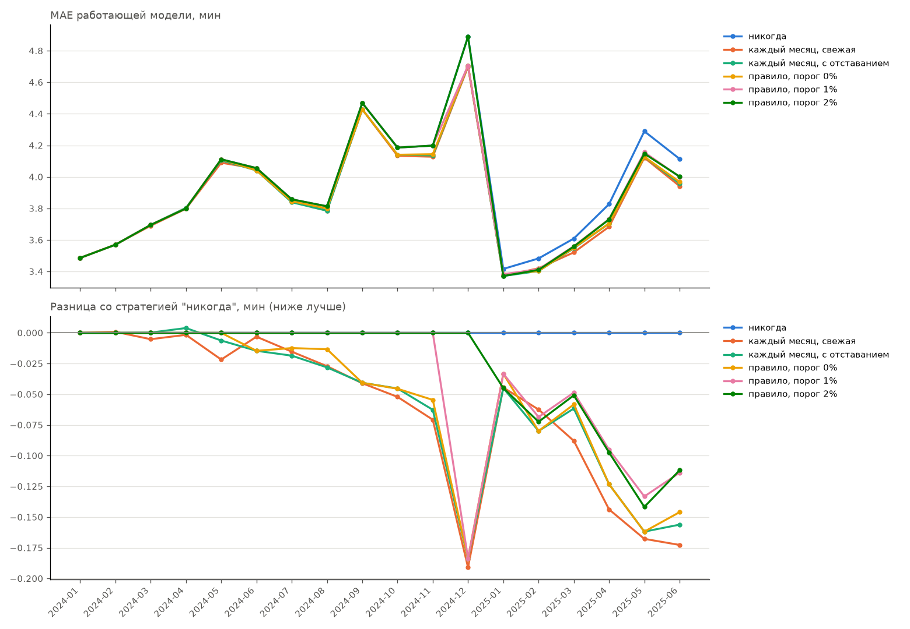
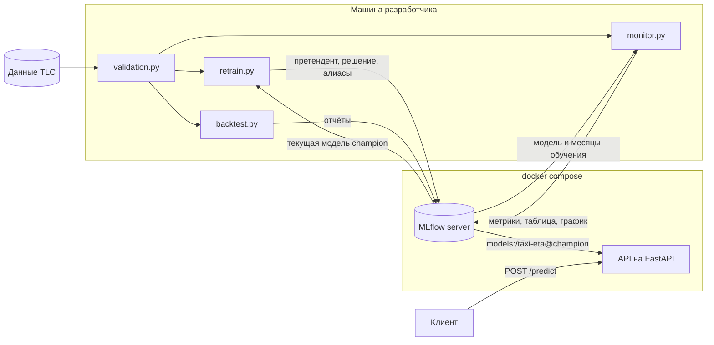

# Taxi ETA - предсказание длительности поездки на такси в Нью-Йорке


Сквозной ML-сервис и пайплайн вокруг него. Модель LightGBM предсказывает
длительность поездки жёлтого такси, сервис на FastAPI загружает актуальную модель
из реестра MLflow. Каждый месяц данных проходит автоматическую проверку,
мониторинг следит за качеством модели и дрейфом данных, а переобучение раз в месяц
выкатывает новую модель, только если она статистически лучше текущей.

## Главное

- **Ошибку модели определяет сезонность, а не её возраст.** Модель, обученная
  на январе и феврале, осенью ошибалась на 30-60% сильнее, чем зимой. Поэтому
  текущая модель обучается на годовом окне с признаком месяца.
  [Подробнее о мониторинге](docs/monitoring.md).
- **Переобучение с проверкой окупается.** На истории 2024-2025 годов ежемесячное
  переобучение по правилу champion/challenger даёт около 1.4% MAE в среднем
  и до 4% к концу полутора лет. Выигрыш претендента проверяется бутстрапом
  по дням. [Подробнее о переобучении и бэктесте](docs/retraining.md).
- **Модель стала в 49 раз быстрее.** Первая модель содержала 2616 деревьев,
  текущая не больше 100, и почти не потеряла в точности.
- **Эффект платы за въезд в центр Манхэттена.** После её введения в январе 2025
  года поездки через центр стали быстрее примерно на 13-37 секунд относительно
  тренда прошлых лет. [Подробнее об анализе](docs/congestion_pricing.md).

Как проект развивался и что пошло не так по дороге, записано в [журнале](docs/journal.md).



## Задача и данные

По зоне посадки, зоне высадки и времени заказа нужно предсказать длительность
поездки в минутах. Используются только признаки, которые известны в момент заказа.
Качество оценивается по средней абсолютной ошибке (MAE) в минутах.

Данные взяты из открытого набора
[NYC TLC Trip Record Data](https://www.nyc.gov/site/tlc/about/tlc-trip-record-data.page),
по одному parquet-файлу на месяц.

| Признак        | Описание                                  |
|----------------|-------------------------------------------|
| `PULocationID` | зона посадки (категориальный признак)     |
| `DOLocationID` | зона высадки (категориальный признак)     |
| `pickup_hour`  | час посадки                               |
| `pickup_dow`   | день недели, 0 соответствует понедельнику |
| `pickup_month` | месяц года                                |

## Архитектура



Обучение и сервис связаны только через реестр моделей MLflow. Переобучение
регистрирует каждого претендента как новую версию модели и переносит на него
алиас `champion`, только если он победил текущую модель. Сервис загружает
версию с этим алиасом.

## Быстрый старт

Для запуска нужны Python 3.12 и Docker. На macOS для LightGBM дополнительно
нужен OpenMP (`brew install libomp`).

```bash
git clone https://github.com/purringcoal/nyc-taxi-eta.git
cd nyc-taxi-eta
python -m venv .venv
source .venv/bin/activate
pip install -r requirements.txt

python -m src.download 2023-01 2025-06
python -m src.validation 2023-01 2025-06

docker compose up -d mlflow
export MLFLOW_TRACKING_URI=http://localhost:5000

python -m src.retrain 2025-05
docker compose up -d --build api

python -m src.monitor 2024-01 2025-06
python -m src.backtest
```

В Windows (cmd) окружение активируется командой `.venv\Scripts\activate`,
а адрес сервера задаётся командой `set MLFLOW_TRACKING_URI=http://localhost:5000`.

Первый запуск `src.retrain` при пустом реестре регистрирует модель как `champion`
без сравнения. Сервис API нужно запускать после этого. После каждой смены
`champion` сервис нужно перезапустить командой `docker compose restart api`.

Интерфейс MLflow открывается по адресу http://localhost:5000, документация API
по адресу http://localhost:8000/docs.

## Пример запроса

Поездка из аэропорта JFK (зона 132) на Таймс-сквер (зона 230) утром в понедельник.

```bash
curl -X POST http://127.0.0.1:8000/predict \
  -H "Content-Type: application/json" \
  -d @request.json
```

```json
{"pickup_datetime": "2024-04-01T08:30:00", "PULocationID": 132, "DOLocationID": 230}
```

Сервис возвращает предсказанную длительность в минутах.

```json
{"duration_min": 60.2}
```

## Тесты

Тесты не читают настоящие данные и не обращаются к серверу MLflow, поэтому
запускаются где угодно за несколько секунд. При каждом пуше GitHub Actions
запускает линтер и тесты.

```bash
python -m pytest
ruff check src tests
```

Тесты закрепляют ошибки, которые уже встречались в проекте. Это несовпадение
типов на входе модели, путаница колонок, поломка старых моделей после изменения
признаков, ошибка связи с MLflow, похожая на отсутствие модели, и утечка будущего
в бэктесте.

## Структура проекта

| Путь                       | Назначение |
|----------------------------|------------|
| `src/download.py`          | загрузка данных |
| `src/validation.py`        | проверка сырых данных месяца |
| `src/features.py`          | очистка, признаки, подготовка входа модели |
| `src/training.py`          | обучение модели на окне месяцев |
| `src/retrain.py`           | переобучение и решение о выкатке |
| `src/monitor.py`           | мониторинг модели по месяцам |
| `src/backtest.py`          | бэктест стратегий переобучения |
| `src/budget.py`            | эксперимент с бюджетом сложности модели |
| `src/api.py`               | REST API на FastAPI |
| `src/`                     | остальные модули (PSI, зоны платы, графики, первая модель) |
| `tests/`                   | тесты на pytest |
| `docs/`                    | подробные описания и журнал проекта |
| `configs/`                 | подобранные гиперпараметры и зоны платы |
| `reports/`                 | таблицы и графики экспериментов |
| `docker-compose.yml`       | запуск сервера MLflow и API |

## Ограничения

- У каждой модели есть слепой месяц года, который уходит на раннюю остановку
  и не попадает в обучение. Это пока не исправлено.
- Сервис загружает модель один раз при старте, после смены модели его нужно
  перезапустить.
- Гиперпараметры подбирались для первой модели, а не для годового окна.
- Сервер MLflow работает на SQLite и без аутентификации.

Ограничения отдельных частей описаны в соответствующих документах в `docs/`.

## Планы

- [x] Тонкая версия: бейзлайн -> API -> Docker
- [x] LightGBM, подбор гиперпараметров через Optuna, трекинг в MLflow
- [x] Проверка данных и мониторинг качества модели
- [x] Анализ эффекта платы за въезд
- [x] Модель на годовом окне, правило champion/challenger, бэктест
- [x] Тесты и CI
- [ ] Обучение на всех 12 месяцах окна без слепого месяца и бэктест этой схемы
- [ ] Горячая перезагрузка модели в API без перезапуска
