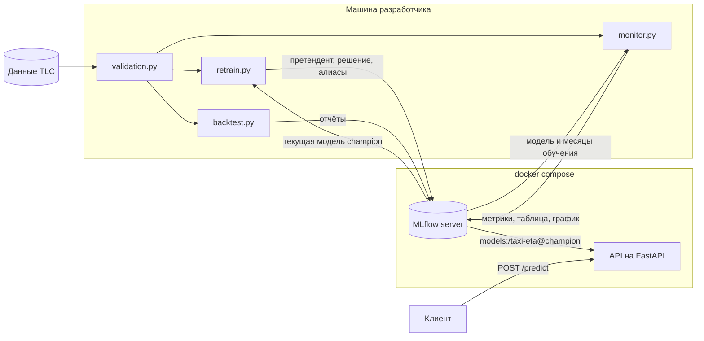

# Taxi ETA - предсказание длительности поездки на такси в Нью-Йорке

Сквозной ML-сервис и пайплайн вокруг него. Модель LightGBM обучается на поездках такси, эксперименты и версии моделей хранятся в MLflow, а сервис загружает
актуальную модель из реестра. Каждый месяц данных проходит автоматическую проверку,
мониторинг измеряет качество модели и дрейф данных, а переобучение раз в месяц
обучает модель-претендента и выкатывает её, только если она статистически лучше
текущей.

На данных за 2022-2025 годы проект показал несколько вещей. Ошибку модели
определяет прежде всего сезонность, поэтому модель обучается на годовом окне
с признаком месяца. Модель стареет медленно, но заметно, и ежемесячное
переобучение с проверкой даёт около 1.4% MAE в среднем и до 4% к концу
полутора лет. Удалось также оценить эффект платы за въезд в центр Манхэттена,
введённой в январе 2025 года.

## Задача

По зоне посадки, зоне высадки и времени заказа нужно предсказать длительность
поездки в минутах. Используются только признаки, которые известны в момент заказа.

Качество оценивается по средней абсолютной ошибке (MAE) в минутах.

$$\mathrm{MAE} = \frac{1}{n}\sum_{i=1}^{n} |y_i - \hat y_i|$$

## Данные

Используются открытые данные
[NYC TLC Trip Record Data](https://www.nyc.gov/site/tlc/about/tlc-trip-record-data.page),
по одному parquet-файлу на месяц, и справочник зон TLC.

При очистке удаляются строки с пропусками, поездки, которые начались за пределами
своего месяца, поездки короче 1 минуты и длиннее 120 минут, а также поездки
с несуществующими номерами зон.

| Признак        | Описание                                  |
|----------------|-------------------------------------------|
| `PULocationID` | зона посадки (категориальный признак)     |
| `DOLocationID` | зона высадки (категориальный признак)     |
| `pickup_hour`  | час посадки                               |
| `pickup_dow`   | день недели, 0 соответствует понедельнику |
| `pickup_month` | месяц года                                |

### Проверка данных

Перед использованием каждый месяц проходит проверку (`src/validation.py`).
Проверяются читаемость файла, наличие и типы нужных колонок, объём данных,
доля пропусков и доля строк, которые проходят правила очистки. Ошибка
останавливает работу с месяцем, предупреждение только сообщает об изменении.
Пороги выставлены по истории за 2022-2025 годы с запасом относительно худшего
нормального месяца.

Порог доли поездок внутри своего месяца сначала был выставлен по 2024-2025
годам и дал ложную тревогу на июне 2022 года, где таких поездок оказалось
144 на миллион против не более 17 на миллион в 2024-2025 годах. Порог ослаблен
до 0.999, потому что проверка нужна для поиска перепутанных или склеенных
файлов, где доля падает намного сильнее.

### Что изменилось в данных в 2025 году

- Появилась колонка `cbd_congestion_fee`, связанная с платой за въезд в центр Манхэттена.
- Поездок стало на 13-23% больше, чем в те же месяцы 2024 года. Поездки, которые
  начинаются или заканчиваются в зоне платы, выросли на 10-18%, остальные
  на 18-32%, поэтому доля поездок через зону платы снизилась с 73-75% до 71-72%.
- Вдвое выросла доля поездок короче минуты (1.2% в июне 2024 года против 2.7%
  в июне 2025 года). Такие поездки отбрасываются при очистке, их природа
  пока не установлена.

## Архитектура



Обучение и сервис связаны только через реестр моделей MLflow. Переобучение
регистрирует каждого претендента как новую версию модели `taxi-eta` и переносит
на него алиас `champion`, только если он победил текущую модель. Сервис при запуске
загружает версию с алиасом `champion`, мониторинг берёт ту же модель, а из запуска,
который её создал, список месяцев обучения.

## Модель

### Текущая модель

LightGBM с функцией потерь L1, так что модель напрямую минимизирует ту же величину,
что и метрика, и предсказывает условную медиану длительности.

$$L(y, F) = |y - F|$$

Модель обучается на окне из 12 месяцев, по 100 тыс. случайных поездок из каждого
месяца, с признаком месяца. Темп обучения 0.2, не больше 100 деревьев. Зоны
переданы как категориальные признаки, остальные гиперпараметры взяты из подбора
Optuna. Модель запоминает список признаков, на которых обучалась, поэтому версии
из реестра продолжают работать после изменений в коде признаков.

### Первая модель и почему от неё отказались

Первая модель была обучена на январе и феврале 2024 года, её гиперпараметры подобраны
Optuna за 30 испытаний, а число деревьев ранней остановкой.

| Модель (тест на марте 2024)  | MAE, мин |
|------------------------------|----------|
| Константа (общая медиана)    | 8.46     |
| Медиана по паре зон          | 4.41     |
| LightGBM, январь-февраль     | 3.60     |

У этой модели оказалось две проблемы. Она знала только зимний сезон, и мониторинг
показал, что осенью и в декабре её ошибка на 30-60% выше, чем зимой. Кроме того,
в ней было 2616 деревьев, и она предсказывала около 830 поездок в секунду, так что
мониторинг полутора лет занимал больше двух часов.

### Бюджет сложности

Время предсказания пропорционально числу деревьев. Чтобы выбрать компромисс между
скоростью и качеством (`src/budget.py`), модель обучалась на 2024 годе с тремя
темпами обучения, и для каждой считалась MAE при разном числе первых деревьев.
Бустинг аддитивен, поэтому одна обученная модель даёт результат для любого числа
деревьев. Проверка шла на январе 2025 года (сезон первой модели) и мае 2025 года
(чужой для неё сезон).

| Модель                     | MAE январь | MAE май | Предсказаний в секунду |
|----------------------------|------------|---------|------------------------|
| первая, 2616 деревьев      | 3.269      | 4.376   | 829                    |
| темп 0.05, 1000 деревьев   | 3.319      | 4.083   | 1 673                  |
| темп 0.1, 200 деревьев     | 3.337      | 4.110   | 15 693                 |
| темп 0.2, 100 деревьев     | 3.372      | 4.143   | 40 747                 |

Почти всё качество набирается за первые 100-200 деревьев. Выбран темп 0.2 и
100 деревьев. В мае такая модель на 5% точнее первой, в январе на 3% хуже,
и в 49 раз быстрее.

## Мониторинг

Мониторинг (`src/monitor.py`) проходит по месяцам после окончания обучающего
окна. Для каждого месяца он проверяет данные, делает предсказания модели
и сравнивает их с фактической длительностью поездок.

Метрики считаются по случайной подвыборке поездок месяца. Стандартная ошибка
медианы остатков на подвыборке в 300 тыс. поездок порядка 0.01-0.02 мин,
смещение PSI из-за конечной выборки порядка 0.001.

| Метрика | Что показывает |
|---|---|
| `mae`, `mae_cbd`, `mae_outside` | ошибка модели в целом, в зоне платы и вне её |
| `bias_cbd`, `bias_outside` | медиана остатков $y - \hat y$ в каждой группе, то есть направление ошибки |
| `bias_gap` | разность медиан остатков в зоне платы и вне её |
| `psi_*` признаков | дрейф распределения входов модели (кроме месяца) |
| `psi_duration` | дрейф распределения фактической длительности |
| `psi_prediction` | дрейф распределения предсказаний |

PSI считается как симметризованная дивергенция Кульбака-Лейблера между долями
категорий в новом месяце $p_i$ и в эталоне $q_i$.

$$\mathrm{PSI} = \sum_i (p_i - q_i)\ln\frac{p_i}{q_i}$$

Месяц года в PSI не участвует. Он меняется от месяца к месяцу по определению,
и PSI по нему бессмыслен (для мая против января-февраля он равен 26.9).

Поездка относится к зоне платы, если начинается или заканчивается в ней.
Список зон TLC внутри зоны платы выведен из данных (`src/cbd_zones.py`).
Поездки, начавшиеся в зоне платы, платят сбор всегда, поэтому зона TLC считается
лежащей внутри зоны платы, если сбор заплатили почти все поездки из неё.
Порог выбран в естественном разрыве распределения долей. Получилось 37 зон,
все в Манхэттене южнее 60-й улицы.


### Что показал мониторинг первой модели

**Ошибку модели определяет сезонность, а не возраст модели.** Лучше всего модель
работала в январе и феврале 2025 года (MAE 3.27 и 3.28), через год после обучения,
но в том же сезоне. Хуже всего в сентябре и декабре 2024 года (4.81 и 5.38).

**Дрейф признаков не означает деградацию.** PSI зон посадки в 2025 году растёт
и к июню достигает 0.146, при этом MAE ниже, чем в тех же месяцах 2024 года.
С качеством модели связан PSI фактической длительности (корреляция с MAE 0.87),
но для него нужны ответы. Поэтому сигналом к переобучению служат остатки,
а не PSI признаков.

## Переобучение и выкатка модели

Переобучение (`src/retrain.py`) запускается после окончания месяца $t$, когда
длительности его поездок уже известны.

1. Все нужные месяцы проходят проверку. Плохой месяц отменяет переобучение.
2. Претендент обучается на 12 месяцах перед $t$.
3. Текущая модель и претендент делают предсказания для одних и тех же поездок
   месяца $t$, которых не видела ни одна из них.
4. Для каждой поездки считается разность абсолютных ошибок, её среднее равно
   выигрышу претендента в MAE.

$$d_i = |e_i^{\text{champion}}| - |e_i^{\text{challenger}}|, \qquad \bar d = \mathrm{MAE}_{\text{champion}} - \mathrm{MAE}_{\text{challenger}}$$

5. Доверительный интервал для $\bar d$ строится бутстрапом по дням.
6. Претендент становится `champion`, если нижняя граница интервала положительна.

Победитель работает в месяце $t+1$. Выкатывается ровно та модель, которую
сравнивали, поэтому она отстаёт на месяц. Бэктест показал, что это отставание
стоит около 0.004 мин.

### Почему бутстрап по дням

Поездки одного дня не независимы. В дождь, в день большого события или аварии
обе модели ошибаются на многих поездках сразу и в одну сторону. Если поездки
одного дня получают общий сдвиг $u$, то при $J$ днях и $n$ поездках

$$\mathrm{Var}(\bar d) \approx \frac{\sigma_u^2}{J} + \frac{\sigma_\varepsilon^2}{n},$$

и точность определяется числом дней, а не поездок. Поэтому в бутстрапе
пересэмплируются целые дни. Наивный интервал, который считает поездки
независимыми, считается только для сравнения.

| Сравнение | Выигрыш претендента, мин | Интервал по дням | Наивный интервал |
|---|---|---|---|
| май 2025, первая модель против годового окна | +0.254 | [+0.158, +0.344] | [+0.237, +0.272] |
| июнь 2025, две модели на годовом окне | +0.017 | [+0.004, +0.029] | [+0.007, +0.026] |

В мае интервал по дням в 5.3 раза шире наивного, то есть 100 тыс. поездок дают
такую же точность, как примерно 3.5 тыс. независимых. В июне разница мала,
потому что две похожие модели одинаково реагируют на особенности дня, и общий
сдвиг в разности ошибок сокращается.

## Бэктест стратегий переобучения

Бэктест (`src/backtest.py`) проживает месяцы с января 2024 по июнь 2025 года
и для каждой стратегии смотрит, какая модель работала бы в каждом месяце и как
она ошибалась бы. Модель для месяца всегда обучена только на данных до него,
все стратегии оцениваются на одних и тех же поездках и начинают с одной модели.
Правило выкатки в бэктесте это та же функция, что работает в `src/retrain.py`.

| Стратегия | Средняя MAE | Разница с "никогда" | Смен модели |
|---|---|---|---|
| никогда не переобучать | 3.937 | | 0 |
| каждый месяц, свежая модель | 3.876 | -0.062 | 17 |
| каждый месяц, с отставанием на месяц | 3.880 | -0.057 | 16 |
| правило, порог 0% | 3.884 | -0.054 | 6 |
| правило, порог 1% | 3.900 | -0.038 | 1 |
| правило, порог 2% | 3.908 | -0.029 | 1 |


**Переобучение окупается, и выигрыш растёт со временем.** В начале 2024 года
стратегии почти не отличаются, к июню 2025 года модель без переобучения отстаёт
на 0.15-0.17 мин, около 4% MAE.

**Проверка почти ничего не стоит.** Свежая модель и модель с отставанием на месяц
отличаются на 0.004 мин, так что отставание ради честного сравнения оправдано.

**Порог выкатки должен быть нулевым.** Правило с порогом 0% собирает 95% возможного
выигрыша при 6 сменах модели вместо 16. Бутстрап сам отсекает претендентов,
неотличимых от текущей модели. Пороги 1-2% работают как "пила". Модель стареет
постепенно, правило ждёт, пока отставание накопится до порога, и в среднем модель
отстаёт примерно на половину порога.

**Правило защищает от плохих моделей.** В феврале 2025 года претендент оказался
хуже текущей модели (выигрыш -0.017, интервал [-0.025, -0.010]), и правило его
не выкатило. Стратегия "каждый месяц" выкатила бы его без проверки.

### Слепой месяц

Бэктест обнаружил дефект схемы обучения. Последний месяц окна уходил на раннюю
остановку, и модель не видела этот месяц года в обучении. Модель "никогда",
обученная на январе-ноябре 2023 года с остановкой по декабрю, в декабре 2024 года
ошибалась на 0.19 мин больше остальных. При этом 16 из 18 моделей бэктеста
упёрлись в предел 100 деревьев, то есть ранняя остановка почти не работала.
Поэтому переобучение переведено на обучение на всех 12 месяцах окна
с фиксированными 100 деревьями. Цифры выше получены по старой схеме,
бэктест новой схемы запланирован.

### Ограничения бэктеста

- Различия между стратегиями с переобучением составляют тысячные доли минуты,
  на уровне шума. Уверенно можно утверждать три вещи. Переобучать стоит,
  отставание дёшево, пороги 1-2% слишком строгие.
- Порог выбран по тому же бэктесту, что даёт лёгкую подгонку под эту историю.
- Цена смены модели в бэктесте не учитывается.

## Эффект платы за въезд в центр Манхэттена

### Метод

Первая модель обучена на зиме 2024 года, поэтому её предсказание отвечает на вопрос,
сколько длилась бы такая же поездка (та же пара зон, тот же час и день недели)
в условиях до введения платы. Остаток $r = y - \hat y$ показывает, насколько
реальность отличается от этого прогноза. Состав поездок при этом учитывается
автоматически, потому что модель знает пару зон, час и день недели.

Модель обучена на потере L1 и предсказывает условную медиану, поэтому без
изменений в мире медиана остатков в любой группе, заданной через признаки,
близка к нулю. Сезонность модель не знает, и она сдвигает остатки во всех
группах сразу, поэтому сравнивается разность групп.

$$\Delta(M) = \mathrm{med}\big(r \mid \text{зона платы}, M\big) - \mathrm{med}\big(r \mid \text{вне зоны}, M\big)$$

У центра оказалась своя сезонность (в декабре 2024 года $\Delta = 1.52$),
поэтому сравниваются одни и те же календарные месяцы разных лет.

### Результат

| Месяц  | 2022  | 2023  | 2024  | 2025  |
|--------|-------|-------|-------|-------|
| март   | -0.58 | -0.00 | +0.26 | -0.11 |
| апрель | -0.50 | -0.09 | +0.41 | +0.18 |
| май    | -0.43 | -0.04 | +0.40 | +0.29 |
| июнь   | -0.15 | +0.10 | +0.41 | +0.27 |


С 2022 по 2024 год поездки через центр год за годом становились медленнее
относительно остального города, примерно на 20-25 секунд в год. Все восемь
изменений год к году до введения платы положительны. В 2025 году тренд
развернулся во всех четырёх месяцах.

Если построить линейный тренд по 2022-2024 годам отдельно для каждой группы,
медиана остатков в центре в 2025 году оказывается ниже тренда на 0.57-0.99 мин,
а вне центра только на 0.11-0.16 мин.

| Допущение о мире без платы | Эффект на $\Delta$, мин | В среднем |
|---|---|---|
| рост остановился бы на уровне 2024 года | от -0.11 до -0.38 | -0.21 (около 13 с) |
| рост продолжился бы линейно | от -0.41 до -0.85 | -0.61 (около 37 с) |

Итоговая оценка эффекта от 13 до 37 секунд, то есть примерно 2-6% времени
поездки через центр.

### Как менялся анализ

| Шаг | Метод | Проблема | Решение |
|---|---|---|---|
| 1 | общая медиана длительности | смешаны группы, состав поездок и сезон | модель как прогноз "что было бы" |
| 2 | разность групп месяц к месяцу | у центра своя сезонность | сравнение год к году |
| 3 | изменение разности год к году | не прошёл плацебо-тест на паре 2023-2024 | добавлен 2022 год |
| 4 | излом тренда 2022-2025 | мало лет, допущение о тренде | две оценки как интервал |

### Ограничения анализа

- Независимых наблюдений столько, сколько лет, то есть мало.
- Линейное продолжение тренда это сильное допущение.
- Поездки, которые проезжают через зону платы транзитом, отнесены к группе
  "вне зоны", что тянет оценку эффекта к нулю.
- Если в 2025 году в центре изменилось что-то ещё, это попадёт в ту же оценку.

## Быстрый старт

Для запуска нужны Python 3.12 и Docker. На macOS для LightGBM дополнительно
нужен OpenMP (`brew install libomp`).

```bash
git clone https://github.com/purringcoal/nyc-taxi-eta.git
cd taxi-eta
python -m venv .venv
source .venv/bin/activate
pip install -r requirements.txt

python -m src.download 2023-01 2025-06
python -m src.validation 2023-01 2025-06

docker compose up -d mlflow
export MLFLOW_TRACKING_URI=http://localhost:5000

python -m src.retrain 2025-05
docker compose up -d --build api

python -m src.monitor 2024-01 2025-06
python -m src.backtest
```

В Windows (cmd) окружение активируется командой `.venv\Scripts\activate`,
а адрес сервера задаётся командой `set MLFLOW_TRACKING_URI=http://localhost:5000`.

Первый запуск `src.retrain` при пустом реестре регистрирует претендента как
`champion` без сравнения. Сервис API нужно запускать после этого, иначе в реестре
нет модели с алиасом `champion`. После каждой смены `champion` сервис нужно
перезапустить командой `docker compose restart api`.

Списки зон платы и подобранные гиперпараметры уже лежат в `configs/`, поэтому
`src.cbd_zones` и `src.tune` можно не запускать. Эксперимент с бюджетом сложности
запускается командой `python -m src.budget`, анализ эффекта платы требует
мониторинга на 2022 и 2023 годах и команды `python -m src.plot_trend_break`.

Интерфейс MLflow открывается по адресу http://localhost:5000, документация API
по адресу http://localhost:8000/docs.

## Пример запроса

Поездка из аэропорта JFK (зона 132) на Таймс-сквер (зона 230) утром в понедельник.

```bash
curl -X POST http://127.0.0.1:8000/predict \
  -H "Content-Type: application/json" \
  -d @request.json
```

Файл `request.json` лежит в корне репозитория.

```json
{"pickup_datetime": "2024-04-01T08:30:00", "PULocationID": 132, "DOLocationID": 230}
```

Сервис возвращает предсказанную длительность в минутах.

```json
{"duration_min": X.X}
```

## Структура проекта

| Файл                       | Назначение |
|----------------------------|------------|
| `src/months.py`            | работа с месяцами, окна, разбор аргументов командной строки |
| `src/download.py`          | загрузка данных и справочника зон, защита от недокачанных файлов |
| `src/features.py`          | чтение, очистка, признаки, подвыборки, подготовка входа модели |
| `src/validation.py`        | проверка сырых данных месяца |
| `src/baseline.py`          | бейзлайн, медиана по паре зон |
| `src/lgbm_model.py`        | обёртка над LightGBM, хранит свой список признаков |
| `src/mlflow_model.py`      | упаковка модели в формат MLflow pyfunc |
| `src/training.py`          | обучение модели на окне месяцев |
| `src/tune.py`              | подбор гиперпараметров первой модели через Optuna |
| `src/train.py`             | обучение первой модели |
| `src/budget.py`            | эксперимент с бюджетом сложности |
| `src/retrain.py`           | переобучение и решение о выкатке (champion/challenger) |
| `src/backtest.py`          | бэктест стратегий переобучения |
| `src/api.py`               | REST API на FastAPI |
| `src/cbd_zones.py`         | вывод списка зон внутри зоны платы из данных |
| `src/drift.py`             | PSI для категориальных и непрерывных величин |
| `src/monitor.py`           | мониторинг модели по месяцам |
| `src/plot_trend_break.py`  | график разности смещений по годам |
| `configs/lgbm_params.json` | подобранные гиперпараметры |
| `configs/cbd_zones.json`   | зоны TLC внутри зоны платы |
| `reports/`                 | таблицы и графики мониторинга, бюджета и бэктеста |
| `Dockerfile`               | образ сервиса API |
| `Dockerfile.mlflow`        | образ сервера MLflow |
| `docker-compose.yml`       | запуск сервера MLflow и API |

## Почему сделано именно так

- Функция потерь L1 выбрана потому, что метрика проекта MAE. Модель с такой
  потерей предсказывает условную медиану, и на этом свойстве построен мониторинг
  смещения.
- Признак `trip_distance` не используется. Это фактическое расстояние, оно
  становится известно только после поездки.
- Всё, что должно совпадать при обучении, в сервисе и в проверке данных, вынесено
  в общие функции и константы.
- Модель хранит список признаков, на которых обучалась. После добавления признака
  месяца старая модель из реестра перестала работать, потому что брала список
  признаков из текущего кода.
- Ограничение на скорость модели задано явно через бюджет сложности. Optuna
  оптимизировала только MAE и нашла модель с 2616 деревьями.
- Подвыборка для обучения берётся поровну из каждого месяца, чтобы каждый сезон
  был представлен одинаково.
- Сравнение моделей парное, на одних и тех же поездках. Ошибки двух моделей
  на одной поездке сильно коррелированы, и дисперсия разности намного меньше.
- Интервал для выигрыша претендента строится бутстрапом по дням, потому что
  поездки одного дня не независимы.
- Отсутствие текущей модели в реестре проверяется явно, без перехвата исключений.
  Иначе ошибка связи с сервером выглядела бы как "модели нет", и претендент
  выкатился бы без сравнения.
- Зависимости модели передаются в MLflow явно из `requirements.txt`. Автоматическое
  определение на Windows падало и записывало в описание модели только `cloudpickle`.
- Порог выкатки выбран по бэктесту, а не на глаз.
- Проверка данных возвращает отчёт, а не бросает исключение, и стоит перед
  обучением, мониторингом и бэктестом.

## Ограничения

- Схема обучения на полном окне ещё не проверена бэктестом.
- Гиперпараметры модели (кроме темпа и числа деревьев) подобраны для первой модели,
  а не для годового окна.
- Модель обучается по 100 тыс. поездок на месяц, достаточность этого объёма
  не проверялась кривой обучения.
- Решение о выкатке принимается по одному месяцу, и из-за сезонности оно может
  зависеть от того, какой это месяц.
- Сервис загружает модель один раз при старте. После смены `champion` контейнер
  нужно перезапустить.
- Каждый претендент регистрируется в реестре, даже отклонённый, и реестр со временем
  растёт.
- Праздники, погода и текущие пробки не учитываются.
- Сервер MLflow работает на SQLite и без аутентификации.

## Планы

- [x] Тонкая версия: бейзлайн -> API -> Docker
- [x] LightGBM с временными признаками, подбор гиперпараметров через Optuna
- [x] Трекинг экспериментов и реестр моделей в MLflow
- [x] Проверка сырых данных и загрузка произвольного диапазона месяцев
- [x] Мониторинг качества модели и дрейфа данных, анализ эффекта платы за въезд
- [x] Облегчённая модель на годовом окне, правило champion/challenger с бутстрапом
- [x] Бэктест стратегий переобучения
- [ ] Бэктест схемы обучения на полном окне
- [ ] Горячая перезагрузка модели в API без перезапуска
- [ ] Тесты (pytest) и CI в GitHub Actions