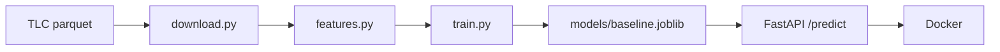

# Taxi ETA - предсказание длительности поездки на такси в Нью-Йорке

Сквозной ML-сервис: загрузка открытых данных -> обучение модели -> REST API -> Docker.
Сейчас это тонкая версия: вся цепочка работает от начала до конца, но каждое
звено минимальное. Дальше буду углублять каждый этап (см. раздел "Планы").

## Задача

По данным, которые известны в момент заказа (зона посадки, зона высадки, время),
предсказать длительность поездки в минутах.

Метрика - MAE (средняя абсолютная ошибка, в минутах):

$$\mathrm{MAE} = \frac{1}{n}\sum_{i=1}^{n} |y_i - \hat y_i|$$

## Результаты

Обучение - январь и февраль 2024, валидация - март 2024.

| Модель                    | MAE на валидации, мин |
|---------------------------|-----------------------|
| Константа (общая медиана) | X.XX                  |
| Медиана по паре зон       | X.XX                  |

Размер выборок: train - N поездок, val - N поездок.

## Данные

[NYC TLC Trip Record Data](https://www.nyc.gov/site/tlc/about/tlc-trip-record-data.page) -
открытые данные о поездках жёлтого такси, по одному parquet-файлу на месяц.

Очистка:
- оставлены только поездки, которые начались внутри своего месяца (в файлах встречаются ошибочные даты);
- оставлены поездки длительностью от 1 до 120 минут.

## Быстрый старт

Нужны Python 3.12 и Docker.

```bash
git clone <ссылка на репозиторий>
cd taxi-eta
python -m venv .venv
source .venv/bin/activate          # Windows: .venv\Scripts\activate
pip install -r requirements.txt

python -m src.download             # скачать данные (~150 МБ)
python -m src.train                # обучить модель и вывести MAE

docker build -t taxi-eta:0.1 .
docker run --rm -p 8000:8000 taxi-eta:0.1
```

## Пример запроса

Поездка из аэропорта JFK (зона 132) на Таймс-сквер (зона 230):

```bash
curl -X POST http://127.0.0.1:8000/predict \
  -H "Content-Type: application/json" \
  -d '{"pickup_datetime": "2024-04-01T08:30:00", "PULocationID": 132, "DOLocationID": 230}'
```

Ответ:

```json
{"duration_min": X.X}
```

Документация API (Swagger): http://127.0.0.1:8000/docs

## Структура проекта



- `src/download.py` - загрузка данных (повторный запуск ничего не скачивает заново)
- `src/features.py` - очистка, целевая переменная, признаки
- `src/baseline.py` - модель: медиана по паре зон
- `src/train.py` - обучение и валидация
- `src/api.py` - REST API на FastAPI

## Почему сделано именно так

- Валидация по времени, а не случайным разбиением. Модель учится на прошлом
  и проверяется на будущем, как и будет в реальной работе. При случайном
  разбиении оценка качества получилась бы завышенной.
- Признак `trip_distance` не используется. Это фактическое расстояние, оно
  известно только после поездки, то есть это утечка целевой переменной.
- Медиана, а не среднее. Константа, которая минимизирует MAE, это как раз медиана.
  У длительностей поездок тяжёлый правый хвост, поэтому среднее смещено
  в сторону длинных поездок.
- Одна и та же функция признаков для обучения и для API. Так признаки на входе
  модели в сервисе гарантированно считаются так же, как при обучении
  (нет training-serving skew).

## Ограничения

- Если пара зон встречалась в обучении 1-2 раза, медиана по ней очень шумная.
- Модель пока не учитывает время суток и день недели (признаки считаются,
  но бейзлайн их не использует).
- Модель лежит внутри Docker-образа, чтобы её обновить, нужно пересобрать образ.

## Планы

- [x] Тонкая версия: бейзлайн -> API -> Docker
- [ ] LightGBM с временными признаками, подбор гиперпараметров через Optuna
- [ ] Трекинг экспериментов и реестр моделей в MLflow
- [ ] Тесты (pytest) и CI в GitHub Actions
- [ ] Мониторинг дрейфа данных (PSI)
- [ ] Автоматическое переобучение
- [ ] Демо на Streamlit или Hugging Face Spaces