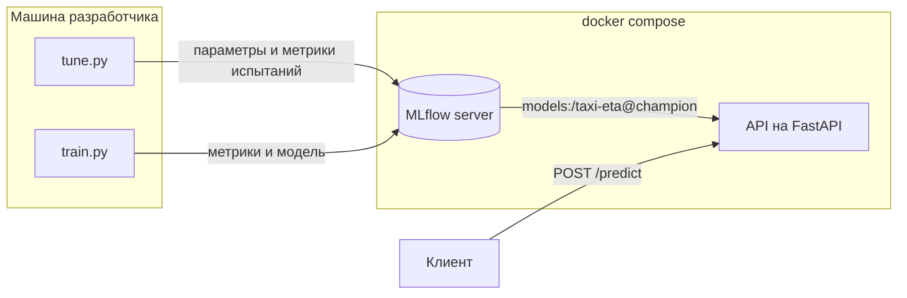

# Taxi ETA - предсказание длительности поездки на такси в Нью-Йорке

Сквозной ML-сервис, который проходит весь путь от открытых данных до REST API
в Docker. Модель LightGBM обучается на поездках жёлтого такси, гиперпараметры
подбираются через Optuna, эксперименты и версии моделей хранятся в MLflow.
Сервис при запуске сам загружает актуальную модель из реестра MLflow.

## Задача

По зоне посадки, зоне высадки и времени заказа нужно предсказать длительность
поездки в минутах. Используются только признаки, которые известны в момент заказа.

Качество оценивается по средней абсолютной ошибке (MAE) в минутах.

$$\mathrm{MAE} = \frac{1}{n}\sum_{i=1}^{n} |y_i - \hat y_i|$$

## Результаты

Все модели обучены на поездках за январь и февраль 2024 года и проверены
на поездках за март 2024 года. Мартовские данные не использовались
ни при подборе гиперпараметров, ни при ранней остановке.

| Модель                    | MAE на тесте (март), мин |
|---------------------------|--------------------------|
| Константа (общая медиана) | 8.46                     |
| Медиана по паре зон       | 4.41                     |
| LightGBM                  | 3.60                     |

LightGBM ошибается в среднем на 0.81 мин меньше, чем медиана по паре зон.
В обучающей выборке 5,897,742 поездок, в тестовой 3,538,513.

## Данные

Используются открытые данные
[NYC TLC Trip Record Data](https://www.nyc.gov/site/tlc/about/tlc-trip-record-data.page),
по одному parquet-файлу на месяц.

При очистке удалены поездки, которые начались за пределами своего месяца
(в исходных файлах встречаются ошибочные даты), а также поездки короче
1 минуты и длиннее 120 минут.

| Признак        | Описание                                  |
|----------------|-------------------------------------------|
| `PULocationID` | зона посадки (категориальный признак)     |
| `DOLocationID` | зона высадки (категориальный признак)     |
| `pickup_hour`  | час посадки                               |
| `pickup_dow`   | день недели, 0 соответствует понедельнику |

## Архитектура



Обучение и сервис связаны только через реестр моделей MLflow. Скрипты обучения
запускаются на машине разработчика и отправляют параметры, метрики и модели
на сервер MLflow. Сервер хранит журнал экспериментов и реестр в SQLite, а файлы
моделей в отдельной папке. И то и другое лежит в томе Docker и сохраняется
при перезапуске контейнеров.

Сервис API при запуске запрашивает у реестра версию модели с алиасом `champion`.
Чтобы обновить модель в сервисе, достаточно перевесить алиас на другую версию
и перезапустить контейнер. Пересобирать образ для этого не нужно.

## Модель

Используется LightGBM с функцией потерь L1, так что модель напрямую минимизирует
ту же величину, что и метрика.

$$L(y, F) = |y - F|$$

Зоны переданы в модель как категориальные признаки. Сплит в дереве имеет вид
"зона входит в множество S", а не "номер зоны меньше 150".

### Подбор гиперпараметров

Гиперпараметры подобраны с помощью Optuna (сэмплер TPE) за 30 испытаний.
Обучение в каждом испытании идёт на подвыборке января (1 млн поездок), а проверка
на подвыборке февраля (300 тыс. поездок). Число деревьев определяется ранней
остановкой с терпением 50 деревьев.

| Параметр            | Диапазон поиска (лог-шкала) | Лучшее значение |
|---------------------|-----------------------------|-----------------|
| `learning_rate`     | 0.02 - 0.3                  | 0.034           |
| `num_leaves`        | 16 - 512                    | 379             |
| `min_child_samples` | 20 - 2000                   | 138             |
| `reg_lambda`        | 0.001 - 10                  | 0.874           |
| `cat_smooth`        | 1 - 100                     | 5.98            |

Каждое испытание записывается в MLflow как вложенный запуск внутри общего
запуска `optuna-search` в эксперименте `taxi-eta-tuning`. Лучшие параметры
сохраняются в `configs/lgbm_params.json` и в артефакты этого запуска.

### Финальное обучение

1. Модель обучается на полном январе с ранней остановкой по полному февралю, так находится число деревьев.
2. С этим числом деревьев модель обучается заново на январе и феврале вместе.
3. Готовая модель один раз проверяется на марте.

Результаты записываются в эксперимент `taxi-eta`. Модель сохраняется в формате
MLflow pyfunc вместе с исходным кодом и сигнатурой входа, регистрируется
в реестре под именем `taxi-eta`, и новой версии присваивается алиас `champion`.

## Быстрый старт (не быстрый, у меня это занимает 4-5 часов)

Для запуска нужны Python 3.12 и Docker. На macOS для LightGBM дополнительно
нужен OpenMP (`brew install libomp`).

```bash
git clone https://github.com/purringcoal/nyc-taxi-eta.git
cd taxi-eta
python -m venv .venv
source .venv/bin/activate
pip install -r requirements.txt

docker compose up -d mlflow
export MLFLOW_TRACKING_URI=http://localhost:5000

python -m src.download
python -m src.tune
python -m src.train

docker compose up -d --build api
```

В Windows (cmd) окружение активируется командой `.venv\Scripts\activate`,
а адрес сервера задаётся командой `set MLFLOW_TRACKING_URI=http://localhost:5000`.

Шаг `src.tune` можно пропустить, потому что подобранные параметры уже лежат
в `configs/lgbm_params.json`.

Сервис API нужно запускать после `src.train`. До этого в реестре нет модели
с алиасом `champion`, и сервис не сможет стартовать.

Интерфейс MLflow открывается по адресу http://localhost:5000, документация API
по адресу http://localhost:8000/docs.

## Пример запроса

Поездка из аэропорта JFK (зона 132) на Таймс-сквер (зона 230) утром в понедельник.

```bash
curl -X POST http://127.0.0.1:8000/predict \
  -H "Content-Type: application/json" \
  -d @request.json
```

Файл `request.json` лежит в корне репозитория.

```json
{"pickup_datetime": "2024-04-01T08:30:00", "PULocationID": 132, "DOLocationID": 230}
```

Сервис возвращает предсказанную длительность в минутах.

```json
{"duration_min": 60.2}
```

Для той же поездки ночью в воскресенье (`"pickup_datetime": "2024-04-07T04:00:00"`)
модель предсказывает 32.4 мин.

## Структура проекта

| Файл                       | Назначение |
|----------------------------|------------|
| `src/download.py`          | загрузка данных, повторный запуск ничего не скачивает заново |
| `src/features.py`          | очистка, целевая переменная, признаки, подготовка входа модели |
| `src/baseline.py`          | бейзлайн, медиана по паре зон |
| `src/lgbm_model.py`        | обёртка над LightGBM с тем же интерфейсом, что у бейзлайна |
| `src/mlflow_model.py`      | упаковка модели в формат MLflow pyfunc |
| `src/tune.py`              | подбор гиперпараметров через Optuna с записью в MLflow |
| `src/train.py`             | обучение, проверка на тесте, регистрация модели |
| `src/api.py`               | REST API на FastAPI |
| `configs/lgbm_params.json` | подобранные гиперпараметры |
| `Dockerfile`               | образ сервиса API |
| `Dockerfile.mlflow`        | образ сервера MLflow |
| `docker-compose.yml`       | запуск сервера MLflow и API |

## Почему сделано именно так

- Данные разбиты по времени на три части. Январь используется для обучения,
  февраль для подбора гиперпараметров и ранней остановки, март для итоговой
  проверки. Если подбирать параметры на том же месяце, по которому считается
  итоговая MAE, оценка получится завышенной.
- Функция потерь L1 выбрана потому, что метрика проекта MAE. При L1 значения
  в листьях деревьев равны медианам остатков, а медиана и есть константа,
  минимизирующая MAE.
- Признак `trip_distance` не используется. Это фактическое расстояние, оно
  становится известно только после поездки, поэтому его использование было бы
  утечкой целевой переменной.
- Час и день недели переданы как целые числа, без sin/cos-кодирования. Дерево
  делит выборку порогами и может выделить любой интервал часов без
  дополнительного кодирования.
- Всё, что должно совпадать при обучении и в сервисе, вынесено в общие функции.
  Признаки считает `add_time_features`, список и порядок колонок задаёт `FEATURES`,
  а `make_model_input` приводит вход модели к типу `int64`. Так исключается
  расхождение между обучением и эксплуатацией (training-serving skew).
- Модель сохранена с сигнатурой, и MLflow проверяет по ней каждый входящий
  запрос. Благодаря этой проверке нашлось расхождение типов: в parquet номера
  зон хранятся как `int32`, а API получает из JSON `int64`.
- Вместе с моделью в MLflow сохраняется исходный код (`code_paths`), поэтому
  модель загружается даже там, где проекта нет.
- Сервис получает модель из реестра по алиасу, а не из файла внутри образа.
  Образ содержит только код, и одна и та же версия образа работает с любой
  версией модели.
- Подбор гиперпараметров и финальное обучение записываются в разные
  эксперименты MLflow, потому что их метрики посчитаны на разных данных
  и сравнивать их между собой нельзя.

## Ограничения

- Алиас `champion` переставляется на новую версию после каждого обучения,
  без сравнения с текущей боевой моделью.
- Если много раз выбирать модель по MAE на марте, этот месяц постепенно
  превратится в валидационный, и оценка станет оптимистичной.
- Сервис загружает модель один раз при старте. После смены алиаса контейнер
  нужно перезапустить.
- Гиперпараметры подобраны на подвыборке. Предполагается, что лучшие
  конфигурации на подвыборке и на полных данных совпадают, это не проверялось.
- Число деревьев найдено на одном месяце обучения, а финальная модель обучена
  на двух, так что она может быть немного недообучена.
- Праздники, погода и текущие пробки не учитываются.
- Сервер MLflow работает на SQLite и без аутентификации. Для одного
  разработчика этого достаточно, для команды или облака нет.
- В образ API попадает полный пакет `mlflow` и лишние для сервиса зависимости
  вроде Optuna, поэтому образ получается тяжёлым.

## Планы

- [x] Тонкая версия: бейзлайн -> API -> Docker
- [x] LightGBM с временными признаками, подбор гиперпараметров через Optuna
- [x] Трекинг экспериментов и реестр моделей в MLflow
- [ ] Тесты (pytest) и CI в GitHub Actions
- [ ] Анализ ошибок по часам, зонам и длине поездки
- [ ] Мониторинг дрейфа данных (PSI)
- [ ] Автоматическое переобучение с проверкой новой модели перед сменой алиаса
- [ ] Демо на Streamlit или Hugging Face Spaces