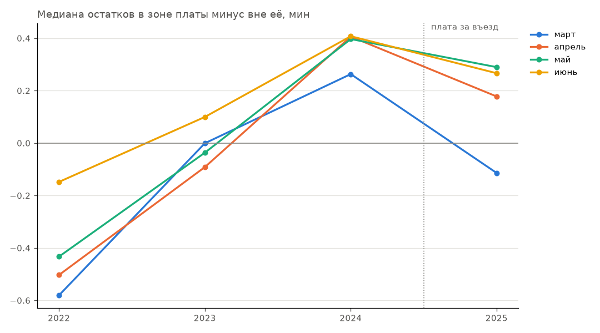

# Эффект платы за въезд в центр Манхэттена

[Назад к README](../README.md)

5 января 2025 года в Нью-Йорке ввели плату за въезд в центр Манхэттена южнее
60-й улицы. Здесь проверяется, стали ли поездки жёлтого такси через центр быстрее.

## Метод

Первая модель обучена на зиме 2024 года, поэтому её предсказание отвечает на вопрос,
сколько длилась бы такая же поездка (та же пара зон, тот же час и день недели)
в условиях до введения платы. Остаток $r = y - \hat y$ показывает, насколько
реальность отличается от этого прогноза. Состав поездок при этом учитывается
автоматически, потому что модель знает пару зон, час и день недели.

Модель обучена на потере L1 и предсказывает условную медиану, поэтому без
изменений в мире медиана остатков в любой группе, заданной через признаки,
близка к нулю. Сезонность модель не знает, и она сдвигает остатки во всех
группах сразу, поэтому сравнивается разность групп.

$$\Delta(M) = \mathrm{med}\big(r \mid \text{зона платы}, M\big) - \mathrm{med}\big(r \mid \text{вне зоны}, M\big)$$

У центра оказалась своя сезонность (в декабре 2024 года $\Delta = 1.52$),
поэтому сравниваются одни и те же календарные месяцы разных лет.

## Результат

| Месяц  | 2022  | 2023  | 2024  | 2025  |
|--------|-------|-------|-------|-------|
| март   | -0.58 | -0.00 | +0.26 | -0.11 |
| апрель | -0.50 | -0.09 | +0.41 | +0.18 |
| май    | -0.43 | -0.04 | +0.40 | +0.29 |
| июнь   | -0.15 | +0.10 | +0.41 | +0.27 |

С 2022 по 2024 год поездки через центр год за годом становились медленнее
относительно остального города, примерно на 20-25 секунд в год. Все восемь
изменений год к году до введения платы положительны. В 2025 году тренд
развернулся во всех четырёх месяцах.

Если построить линейный тренд по 2022-2024 годам отдельно для каждой группы,
медиана остатков в центре в 2025 году оказывается ниже тренда на 0.57-0.99 мин,
а вне центра только на 0.11-0.16 мин.

| Допущение о мире без платы | Эффект на $\Delta$, мин | В среднем |
|---|---|---|
| рост остановился бы на уровне 2024 года | от -0.11 до -0.38 | -0.21 (около 13 с) |
| рост продолжился бы линейно | от -0.41 до -0.85 | -0.61 (около 37 с) |

Итоговая оценка эффекта от 13 до 37 секунд, то есть примерно 2-6% времени
поездки через центр.

## Как менялся анализ

| Шаг | Метод | Проблема | Решение |
|---|---|---|---|
| 1 | общая медиана длительности | смешаны группы, состав поездок и сезон | модель как прогноз "что было бы" |
| 2 | разность групп месяц к месяцу | у центра своя сезонность | сравнение год к году |
| 3 | изменение разности год к году | не прошёл плацебо-тест на паре 2023-2024 | добавлен 2022 год |
| 4 | излом тренда 2022-2025 | мало лет, допущение о тренде | две оценки как интервал |

Плацебо-тест на паре 2023-2024 годов, где реформы не было, дал изменения
от +0.26 до +0.50 мин, больше по модулю, чем предполагаемый эффект. Данные
за 2022 год показали, что это не шум, а устойчивый тренд, и сравнивать 2025 год
нужно с продолжением тренда, а не с прошлым годом.

## Ограничения

- Независимых наблюдений столько, сколько лет, то есть мало.
- Линейное продолжение тренда это сильное допущение.
- Поездки, которые проезжают через зону платы транзитом, отнесены к группе
  "вне зоны", что тянет оценку эффекта к нулю.
- Если в 2025 году в центре изменилось что-то ещё, это попадёт в ту же оценку.