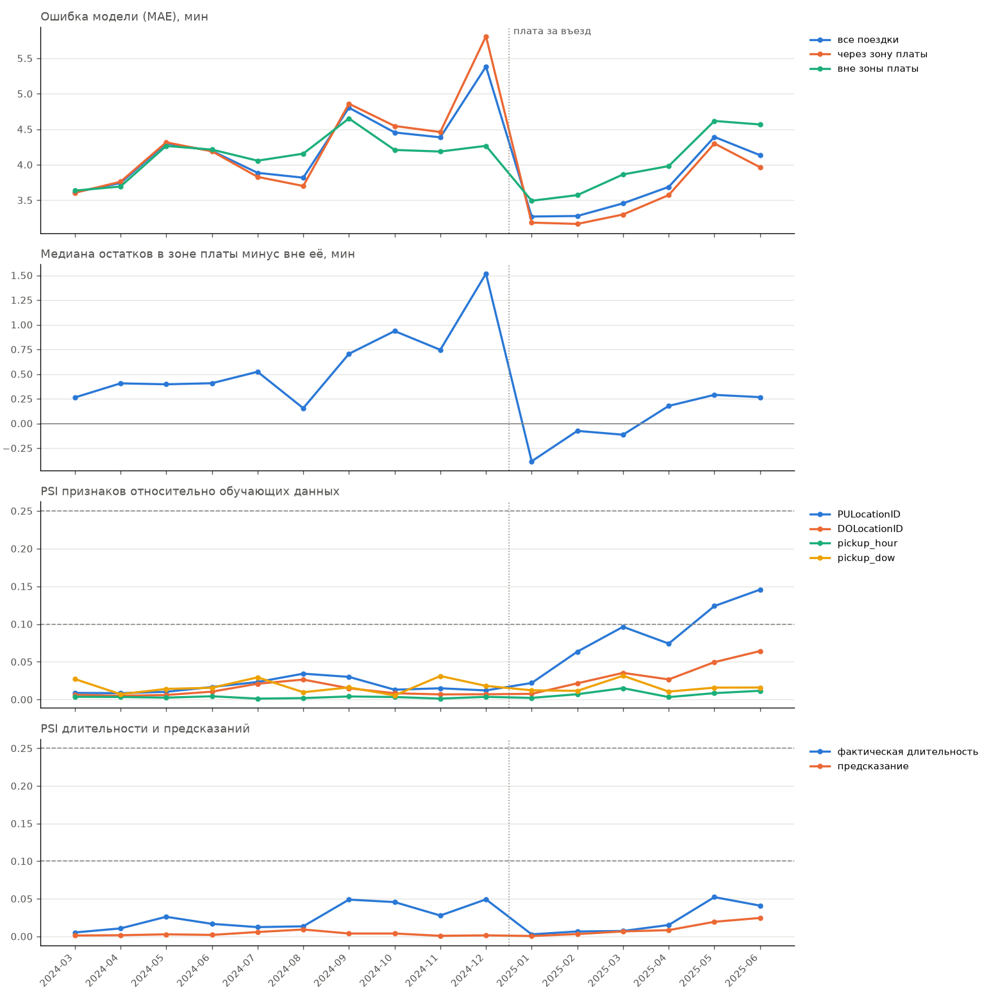

# Данные и мониторинг

[Назад к README](../README.md)

## Проверка данных

Перед использованием каждый месяц проходит проверку (`src/validation.py`).
Проверяются читаемость файла, наличие и типы нужных колонок, объём данных,
доля пропусков и доля строк, которые проходят правила очистки. Ошибка
останавливает работу с месяцем, предупреждение только сообщает об изменении.
Проверка стоит перед обучением, мониторингом и бэктестом.

При очистке удаляются строки с пропусками, поездки, которые начались за пределами
своего месяца, поездки короче 1 минуты и длиннее 120 минут, а также поездки
с несуществующими номерами зон. Очистка и проверка используют одни и те же
правила из `src/features.py`.

Пороги выставлены по истории за 2022-2025 годы с запасом относительно худшего
нормального месяца. Порог доли поездок внутри своего месяца сначала был выставлен
по 2024-2025 годам и дал ложную тревогу на июне 2022 года, где таких поездок
оказалось 144 на миллион против не более 17 на миллион в 2024-2025 годах.
Порог ослаблен до 0.999, потому что проверка нужна для поиска перепутанных
или склеенных файлов, где доля падает намного сильнее.

## Что изменилось в данных в 2025 году

- Появилась колонка `cbd_congestion_fee`, связанная с платой за въезд в центр Манхэттена.
- Поездок стало на 13-23% больше, чем в те же месяцы 2024 года. Поездки, которые
  начинаются или заканчиваются в зоне платы, выросли на 10-18%, остальные
  на 18-32%, поэтому доля поездок через зону платы снизилась с 73-75% до 71-72%.
- Вдвое выросла доля поездок короче минуты (1.2% в июне 2024 года против 2.7%
  в июне 2025 года). Такие поездки отбрасываются при очистке, их природа
  пока не установлена.

## Мониторинг

Мониторинг (`src/monitor.py`) проходит по месяцам после окончания обучающего
окна. Для каждого месяца он проверяет данные, делает предсказания модели
и сравнивает их с фактической длительностью поездок. Результаты пишутся в MLflow
и в папку `reports`.

Метрики считаются по случайной подвыборке поездок месяца. Стандартная ошибка
медианы остатков на подвыборке в 300 тыс. поездок порядка 0.01-0.02 мин,
смещение PSI из-за конечной выборки порядка 0.001.

| Метрика | Что показывает |
|---|---|
| `mae`, `mae_cbd`, `mae_outside` | ошибка модели в целом, в зоне платы и вне её |
| `bias_cbd`, `bias_outside` | медиана остатков $y - \hat y$ в каждой группе, то есть направление ошибки |
| `bias_gap` | разность медиан остатков в зоне платы и вне её |
| `psi_*` признаков | дрейф распределения входов модели (кроме месяца) |
| `psi_duration` | дрейф распределения фактической длительности |
| `psi_prediction` | дрейф распределения предсказаний |

### PSI

PSI считается как симметризованная дивергенция Кульбака-Лейблера между долями
категорий в новом месяце $p_i$ и в эталоне $q_i$.

$$\mathrm{PSI} = \sum_i (p_i - q_i)\ln\frac{p_i}{q_i}$$

Все признаки модели дискретны, поэтому каждое значение считается отдельной
категорией. Длительность и предсказания делятся на 10 корзин по квантилям эталона.
Для двух нормальных распределений со сдвигом 0.5 теория даёт 0.25, а PSI на
10 корзинах 0.242. Разбиение на корзины теряет информацию, и дивергенция может
только уменьшиться.

Месяц года в PSI не участвует. Он меняется от месяца к месяцу по определению,
и PSI по нему бессмыслен (для мая против января-февраля он равен 26.9).

### Зона платы

Поездка относится к зоне платы, если начинается или заканчивается в ней.
Список зон TLC внутри зоны платы выведен из данных (`src/cbd_zones.py`).
Поездки, начавшиеся в зоне платы, платят сбор всегда, поэтому зона TLC считается
лежащей внутри зоны платы, если сбор заплатили почти все поездки из неё.
Доли у зон внутри лежат от 0.94 до 0.99, у ближайших зон снаружи не превышают
0.58, и порог выбран в этом разрыве. Получилось 37 зон, все в Манхэттене
южнее 60-й улицы.

## Что показал мониторинг первой модели

**Ошибку модели определяет сезонность, а не возраст модели.** Лучше всего модель
работала в январе и феврале 2025 года (MAE 3.27 и 3.28), через год после обучения,
но в том же сезоне. Хуже всего в сентябре и декабре 2024 года (4.81 и 5.38).
Корреляция MAE с медианой остатков вне зоны платы равна 0.85, то есть плохие
месяцы это в первую очередь систематическая недооценка длительности.

**Дрейф признаков не означает деградацию.** PSI зон посадки в 2025 году растёт
и к июню достигает 0.146, при этом MAE ниже, чем в тех же месяцах 2024 года.
С качеством модели связан PSI фактической длительности (корреляция с MAE 0.87),
но для него нужны ответы. Поэтому сигналом к переобучению служат остатки,
а не PSI признаков.

**Рост поездок пришёлся в основном на поездки вне центра.** Это объясняет, почему
общая медиана длительности в 2025 году выросла, хотя поездки через центр
относительно ускорились.

## Ограничения

- Метрики считаются по подвыборке, а не по всем поездкам месяца.
- Эталон для дрейфа это данные, на которых обучалась модель. Для модели на двух
  зимних месяцах PSI летом растёт просто из-за сезонности.